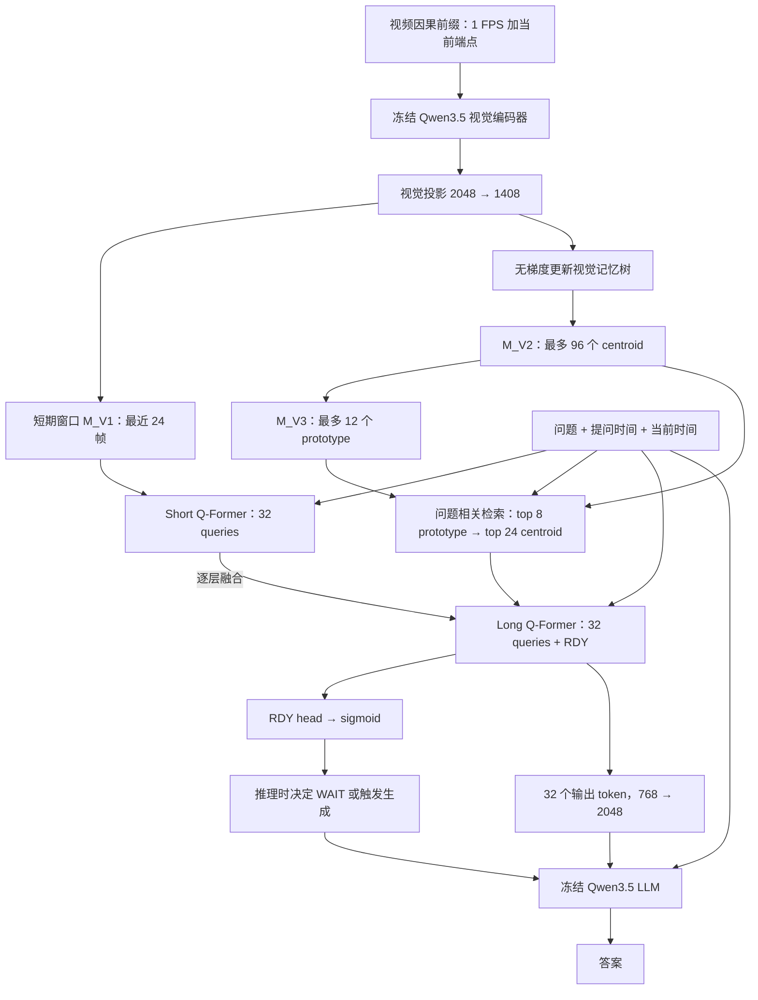

# StreamReady 超声适配：架构、损失、消融与 overfit 总结

状态日期：2026-11-24。以实际运行目录、冻结代码和评估文件为依据；指标提取及原报告 SHA-256 见 [evidence.json](streamready_status_20261124/evidence.json)。

当前已完成 **StreamReady + Qwen3.5-2B 的超声数据适配、并行训练、3/10 视频 overfit 和数项消融**。答案内容在 10 视频训练集上达到 71/71，但当前选择的完整配置只有 36/71 个问题按时触发且答对；readiness 尚未完全拟合。全量 train/holdout 训练已提交，本文取证时两项作业仍为 PENDING，尚无泛化结果。

## 1. 复现范围与论文的关系

保留的主要机制是三层视觉记忆、问题条件化的双分支 Q-Former、短期到长期的逐层融合、长期分支内的 `<RDY>` token，以及 readiness 梯度隔离。

论文的 readiness 监督来自推理表示与记忆相似度构造的伪正/负时间区域，目标为 pairwise CL 加时间正则；该 loss 只更新 RDY token 和 head。当前实现使用已有真实标注 WAIT/ANSWER，并额外加入 BCE。这些是有意保留的适配差异。[论文 §3.4](https://arxiv.org/html/2603.08620v1#S3.SS4)

原论文训练数据为 MSRVTT-QA 10k、MSVD-QA 10k、ActivityNet-QA 32k、MovieChat-1k 10k，共 62k；使用 1 FPS、224×224 输入。我们的训练数据是超声 QA，当前输入为 256×256。因此目前完成的是方法适配和训练链路验证，论文原始 benchmark 数值复现尚未完成。[论文附录 D](https://arxiv.org/html/2603.08620v1#A4)

| 项目 | 当前超声版本 |
|---|---|
| Backbone | Qwen3.5-2B，冻结视觉编码器和语言模型 |
| Q-Former 初始化 | BERT-base 架构/基础权重，再加载 InstructBLIP Q-Former 权重到两个分支 |
| QA 监督 | 真实 ANSWER 端点上的答案 NTP |
| Readiness 监督 | 真实 WAIT/ANSWER；CL + 0.1 TR + 等权 BCE |
| 训练安排 | 一个联合训练循环；readiness 梯度隔离；不依赖原 Stage1/2/3 checkpoint |
| 历史 QA contextual memory bank | 当前关闭；只启用视觉记忆树 |
| 判断阈值 | 固定 0.5，概率大于等于阈值即触发 |
| 时间评估 | 标注端点上的稀疏首次触发回放，尚非逐帧完整 ARS 评估 |

## 2. 架构与实际输入



### 2.1 视频、记忆与检索

- 从 0 秒到当前观察时间采样 1 FPS，并补充实际决策端点；读取帧的 PTS 不超过当前观察时间。非整数端点从整数时间轴分叉，避免另一个问题的额外帧进入共享历史。
- 保持宽高比缩放并 padding 到 256×256。Qwen3.5 的 patch size=16、spatial merge=2，因此每帧产生 **64 个、2048 维视觉 token**。
- 通过可训练投影映射到 1408 维，兼容 InstructBLIP 的视觉 cross-attention 权重。
- 短期窗口最多 24 帧，即最多 **1536 个视觉 token**。它们不是 24 个图像级标量。
- 历史记忆的每个 centroid/prototype 当前只有一个池化描述 token；容量分别为 96、12。检索最多 8 个 prototype 和其候选池中最多 24 个 centroid，给长期分支最多 32 个历史 token。可用槽位不足时使用 mask；尚无历史记忆时回退到短期窗口。
- 检索没有“相似度不够就拒绝所有候选”的额外门槛；top-k 选择与记忆更新时的自适应合并阈值是两件事。

记忆维护采用当前源码中的 EMA：

\[
c_j\leftarrow(1-\alpha)c_j+\alpha f_{\mathrm{evicted}},\qquad \alpha=0.985.
\]

这里 **0.985 乘在新描述上**；不能按常见 EMA 命名习惯误写成 0.985 乘旧值。匹配不足时新增 centroid，容量满后合并到最近者；prototype 在饱和或分布漂移时更新/重聚类。记忆维护本身在 `no_grad` 下完成，不通过整段 EMA 历史反向传播。

冻结版本还有一个应明确的实现细节：第 25 帧进入时，先把 FIFO 更新为第 2–25 帧，再用该窗口初始化最多 24 个 centroid，随后处理被挤出的第 1 帧。以后第 2 帧等再次被挤出时仍会更新 centroid。因此这是一次初始化加逐帧增量更新，且初始化与后续更新存在重叠；不是每累计 24 帧才聚类一次。当前实验配置已记录并保留此行为，尚未完成针对该初始化重叠的消融。

来源：[memory](../StreamReady/lavis/models/streamready/visual_memory.py)、[retrieval](../StreamReady/lavis/models/streamready/retrieval.py)、[parallel forward](../endtoend/parallel.py)。

### 2.2 两个 Q-Former、readiness head 与 LLM 输入

两个 Q-Former 各自有 32 个可学习 query，隐层 768 维；BERT-base 配置提供 12 层结构，视觉 cross-attention 每隔一层加入。两分支参数独立。Long 分支还增加一个 RDY query，短期表示通过 `per_layer` 融合进入长期分支。

Readiness head 的实际结构是：

```text
RDY hidden [768]
 → LayerNorm(768)
 → Linear(768, 768)
 → GELU
 → Identity（dropout=0）
 → Linear(768, 1)
 → logit s
 → sigmoid(s) = p_ready
```

最后一层初始权重和 bias 为 0，所以初始概率为 0.5；在当前 `>=0.5` 规则下，未训练模型可能全部触发。

LLM 收到的是 **32 个投影后的连续视觉/推理 prefix token + 文本问题 prompt**，而非全部原始帧或完整记忆树。Prompt 当前为：

```text
Question asked at {query_time} seconds. Current time: {current_time} seconds.
{question}
Answer:
```

训练时还拼接标准答案和 EOS 做 teacher forcing，但 prefix、问题、padding 不计入答案 CE。推理时只有 prefix 和 prompt，后续 token 自回归生成。答案时刻、未来证据、ASR 和审核备注不进入输入。

来源：[core module](../StreamReady/lavis/models/streamready/module.py)、[head](../StreamReady/lavis/models/streamready/readiness.py)、[answer loss](../StreamReady/lavis/models/blip2_models/streamready.py)、[prompt allowlist](../endtoend/data.py)。

### 2.3 初始化与训练参数

| 参数组 | 状态/来源 |
|---|---|
| Qwen3.5-2B 视觉编码器、LLM | 冻结，无 LoRA |
| Short/Long Q-Former 与 query tokens | 可训练；BERT-base 初始化后加载 `instruct_blip_vicuna7b_trimmed.pth` 的相关 Q-Former 权重 |
| 输入/输出投影、短长融合、新增模块 | 从本次原始初始化开始训练 |
| RDY token、readiness head | 可训练 |
| FIFO / centroid / prototype 数值状态 | 在线缓冲状态，不是优化器参数 |

已完成 10 视频 all-pairs run 的参数记录：可训练标记参数 **463,649,409**，冻结参数 **2,213,241,664**。其中硬 top-k 的索引选择不可微；“在可训练参数集合里”不保证每个检索参数都在每个 batch 获得梯度。

当前全量运行的 Qwen snapshot 为 `15852e8c16360a2fea060d615a32b45270f8a8fc`；配置为 `init_checkpoint=null`、`restore_optimizer=false`。四臂 fresh 消融、最终 all-pairs rerun 和全量训练均使用原始预训练初始化及新优化器，不从超声 overfit checkpoint 继续。早期 3 视频/10 视频续训实验则另行标明。

## 3. 当前损失及公式

设端点集合为 \(\mathcal E\)，端点 \(e=(q,t)\) 的 readiness logit 为 \(s_e\)，概率 \(p_e=\sigma(s_e)\)，真实标签 \(y_e\in\{0,1\}\)。WAIT=0、ANSWER=1。每个问题有正端点集合 \(P_q\) 和负端点集合 \(N_q\)。

### 3.1 答案交叉熵：NTP

\[
\mathcal L_{\mathrm{NTP}}
=-\frac{1}{\sum_{e:y_e=1}L_e}
\sum_{e:y_e=1}\sum_{k=1}^{L_e}
\log P_\theta(a_{e,k}\mid Z_e,x_e,a_{e,<k}).
\]

\(Z_e\) 是连续 prefix，\(x_e\) 是问题 prompt；\(L_e\) 包含实际监督的答案/EOS token，截断与 padding mask 后计数。当前训练按全部有效答案 token 归一化。

**NTP 就是答案 CE，不意味着在更新 LLM 权重。** 冻结 LLM 仍保留对输入 prefix 的反向传播，NTP 用来优化 Q-Former、融合、投影等上游模块。

所有真实 ANSWER 端点都计算 NTP，哪怕当前 readiness 判断 WAIT。真实 WAIT 端点不生成用于 NTP 的答案，也不把 WAIT 当作答案文本训练。因此“模型全预测 WAIT 就没有答案监督”的旧问题已经修正。

### 3.2 Readiness BCE：绝对标签监督

\[
\mathcal L_{\mathrm{BCE}}^{(w_+)}
=-\frac{1}{|\mathcal E|}\sum_{e\in\mathcal E}
\left[w_+y_e\log p_e+(1-y_e)\log(1-p_e)\right].
\]

实际使用数值稳定的 `binary_cross_entropy_with_logits`。当前 \(w_+=1\)，ANSWER/WAIT 等权；消融中的正类加权版为 \(w_+=2\)。分母仍为端点数，不按加权总量重新归一化。

BCE 约束绝对决策：ANSWER 应接近 1、WAIT 应接近 0，并覆盖只有单一标签、无法构成 CL 配对的问题。

### 3.3 同题 ANSWER–WAIT 对比损失：CL

设 \(\mathcal Q_{+-}\) 为同时具有 ANSWER 和 WAIT 的问题集合：

\[
\mathcal L_{\mathrm{CL}}
=\frac{1}{|\mathcal Q_{+-}|}\sum_{q\in\mathcal Q_{+-}}
\frac{1}{|P_q||N_q|}
\sum_{i\in P_q}\sum_{j\in N_q}
-\log\sigma(s_i-s_j).
\]

等价实现为 \(\operatorname{softplus}(s_j-s_i)\)。CL 使用 **logit 差**；TR 使用 sigmoid 后的概率差，不应混写。

当前用每个问题内全部 \(P_q\times N_q\)，不跨问题或视频配对；先题内平均，再在可配对问题间平均，因此 WAIT 更多的问题不会仅因配对多就拥有更大总权重。没有正负配对时 CL 为零。

它约束“ANSWER 比 WAIT 分数高”，本身不保证两类位于 0.5 阈值的两侧；这解释了单用 CL+TR 与加入 BCE 后行为不同。源代码见 [timing_loss.py](../endtoend/timing_loss.py) 和 [ALL_PAIRS.md](../endtoend/ALL_PAIRS.md)。

### 3.4 时间一致性正则：TR / TV

把问题 \(q\) 的不同端点按时间排列为 \(t_{q,1}<\cdots<t_{q,n_q}\)，令 \(\mathcal Q_{TV}\) 包含至少两个端点的问题：

\[
\mathcal L_{\mathrm{TR}}
=\frac{1}{|\mathcal Q_{TV}|}\sum_{q\in\mathcal Q_{TV}}
\frac{1}{n_q-1}\sum_{k=1}^{n_q-1}
|p_{q,k+1}-p_{q,k}|.
\]

当前时间轴是**不规则间隔的标注端点**，不是每一秒都产生 readiness 训练标签。实现不除以 \(t_{q,k+1}-t_{q,k}\)；这是相邻分数的 total variation，不是按秒归一化的导数惩罚。它抑制波动，不强制分数单调上升。

### 3.5 总 loss 与梯度隔离

当前固定配置为：

\[
\boxed{\mathcal L_{\mathrm{total}}
=\mathcal L_{\mathrm{NTP}}
+\mathcal L_{\mathrm{CL}}
+0.1\mathcal L_{\mathrm{TR}}
+\mathcal L_{\mathrm{BCE}}^{(1)}}.
\]

设 \(\mathcal L_R=\mathcal L_{\mathrm{CL}}+0.1\mathcal L_{\mathrm{TR}}+\mathcal L_{\mathrm{BCE}}\)。**这个标量表达式需要与梯度路由一起理解**：

| 参数 | 当前允许的梯度来源 |
|---|---|
| Q-Former / 融合 / 投影等推理路径 | NTP；readiness loss 不改写该路径 |
| RDY token | readiness loss；同时允许来自 NTP 的计算路径梯度 |
| Readiness head | readiness loss |
| 冻结视觉编码器与 LLM 权重 | 不更新 |

`_readiness_surrogate` 用 `autograd.grad` 只对 RDY/head 求 readiness 梯度，再通过代理项回填；保持日志数值等于原 loss。共享一次前向，梯度隔离增加反向遍历，不要求再做一次完整前向。当前不开 gradient checkpointing。

联合梯度方案则直接对总 loss `backward()`，BCE/CL/TR 也会修改 Q-Former 等推理参数。这是我们做过的早期 A/B。当前“联合训练”描述同一训练循环；“梯度隔离”描述参数更新范围，两者不矛盾，也不是先训练 Q-Former 再单独训练 RDY。

多卡时分别按全局答案 token 数、端点数、可配对问题数和 TV 有效问题数归一化，避免简单平均每张卡的均值产生偏差。见 [optimization.py](../endtoend/optimization.py)、[distributed.py](../endtoend/distributed.py)。

## 4. 数据与评估口径

| 用途 | 视频 | QA | 监督端点 | ANSWER / WAIT |
|---|---:|---:|---:|---:|
| 早期 overfit | 3 | 24 | 60 | 24 / 36 |
| 10 视频 overfit / 消融 | 10 | 72 | 175 | 71 / 104 |
| 当前全量 train | 171 | 5236 | 12385 | 5177 / 7208 |
| 当前 holdout | 16 | 464 | 994 | 464 / 530 |
| 已推送的数据 demo | 10 个 holdout 视频 | 286 | 展示用 | 是 holdout 子集 |

**overfit 的 10 视频/72 QA 与 demo 的 10 视频/286 QA 是不同子集。** 官方划分的 train 为 180 视频，本轮 V4 导出有 9 个明确排除项，实际使用 171。每类 train QA 各 1309，包含可立即回答的普通 QA。10 视频小样本也包含 36 条即时 QA，并非只有 WAIT→ANSWER 问题。

QA 数与端点数不同：一个问题可能有多个 WAIT 端点和一个 ANSWER 端点。10 视频子集有 71 个有答案问题、1 个 WAIT-only 问题，35 个可正负配对的问题，共 100 个同题正负组合。当前全量 train 为 6972 对/epoch，holdout 为 530 对。

四个主要指标：

1. **ANSWER 正确触发率**：所有真实 ANSWER 端点中，\(p\ge0.5\) 的比例，分母为 ANSWER 端点数。
2. **WAIT 正确率**：所有真实 WAIT 端点中，\(p<0.5\) 的比例；WAIT 误触发率是其补数。
3. **时机和答案都正确**：对每个有答案问题，在标注端点上按时间回放，首次触发必须位于合法 ANSWER 时刻且生成文本匹配答案；提前触发即使之后能答对也不算成功。分母为有答案问题数。
4. **强制答案正确率**：在真实 ANSWER 端点，无论预测 WAIT/ANSWER，都强制生成并评估答案。它单独检验内容能力，不包含触发要求。

四臂与 all-pairs 主表采用 `readiness_vqa.answers_match` 的归一化/数值/短语匹配规则；不是临床专家判断。早期 A/B 和记忆诊断保留历史 exact-match 指标，不能忽略口径区别。稀疏端点之间尚可能存在漏检的提前触发，因此这些指标不等同于逐秒流式 ARS。

## 5. 已完成消融

### 5.1 四臂损失比较：共同原始初始化

相同 10 视频、数据与 batch 顺序；相同原始预训练初始化指纹、seed=20261121、新 Adam、100 epochs/300 updates、BS64、GA1、readiness 梯度隔离。下表全部取 epoch100、固定阈值 0.5。CL 在这组比较中采用抽样配对；TR 权重统一为 0.1。

| 损失配置 | ANSWER 触发 | WAIT 正确 | 首次按时且答对 | 强制答案正确 | WAIT 误触发 |
|---|---:|---:|---:|---:|---:|
| NTP + BCE | 33/71 | 104/104 | 33/71 | 68/71 | 0/104 |
| NTP + CL + 0.1 TR | 49/71 | 32/104 | 24/71 | 71/71 | 72/104 |
| NTP + CL + 0.1 TR + BCE，正类权重 2 | 49/71 | 69/104 | 33/71 | 68/71 | 35/104 |
| NTP + CL + 0.1 TR + BCE，等权 | 36/71 | 94/104 | 32/71 | 71/71 | 10/104 |

纯 CL+TR 的 ANSWER 触发较多，同时 WAIT 误触发也多。等权 BCE 混合方案保持 71/71 内容正确，并显著减少相对于纯 CL+TR 的误触发；但此表不能说它在所有指标上都优于纯 BCE。当前配置由用户在固定阈值 0.5 下选择，再开展全配对验证。

早期自动选择器曾在同一训练集上扫描阈值并选中纯 BCE。那是不同的选择规则；不与固定 0.5 的主表混算，也不视为独立验证集调参。

### 5.2 抽样配对 vs 全量同题配对

在等权混合 loss 下，从相同原始初始化重训，保持 100 epochs/300 updates 和 batch 顺序一致；只改配对策略。每 epoch 实际使用的配对由 35 个抽样对增加到全部 100 对。

| 配对策略 | ANSWER 触发 | WAIT 正确 | 首次按时且答对 | 强制答案正确 |
|---|---:|---:|---:|---:|
| 抽样配对 | 36/71 | 94/104 | 32/71 | 71/71 |
| 全量同题配对 | 36/71 | 104/104 | 36/71 | 71/71 |

全配对消除了该训练集上 10 个 WAIT 端点误触发，首次按时且答对增加 4 个问题；ANSWER recall 没有提高，仍漏触发 35 个问题。并非所有 ANSWER 与所有 WAIT 跨问题组合，也不需要额外的视频前向。

### 5.3 联合梯度 vs readiness 梯度隔离

早期 3 视频 A/B：从同一已有 checkpoint/Adam 续训，BS8，每臂 24 epochs/224 updates，相同数据与 batch 安排，loss 均为 NTP+BCE。

| 梯度策略 | 强制答案 exact match | ANSWER 触发 | WAIT 误触发 | 门控后答案 exact match |
|---|---:|---:|---:|---:|
| 总 loss 直接联合反传 | 16/24 | 24/24 | 2/36 | 16/24 |
| Readiness 仅更新 RDY/head | 23/24 | 14/24 | 6/36 | 14/24 |

这一结果显示内容拟合与触发拟合的取舍；隔离在这次实验中改善了内容正确率，但不是 readiness 指标更好。初始评估存在小幅差异，且这是单 seed 的旧 checkpoint 续训，不具备后续四臂 fresh 比较的全部控制条件。当前采用隔离是遵循论文机制和用户选择，不能把这张表解释成隔离全面胜出。

### 5.4 长期记忆与 prefix 干预

对较早的 10 视频 BCE checkpoint 做零更新推理干预，保留问题、短期融合和 mask。不是当前 all-pairs checkpoint 的重训练消融。

| 条件 | 强制答案 exact match | ANSWER 触发 | WAIT 误触发 | 旧版平均答案 CE |
|---|---:|---:|---:|---:|
| 正常长期记忆 | 71/71 | 29/71 | 0/104 | 0.00734 |
| 检索出的长期槽位置零 | 71/71 | 29/71 | 0/104 | 0.00905 |
| 换成其他视频的长期槽位 | 71/71 | 29/71 | 0/104 | 0.00742 |
| 仅把送入 LLM 的 prefix 置零 | 0/71 | 29/71 | 0/104 | 3.72182 |

结论：模型依赖已学得的 prefix，但小样本的 100% 内容正确不能证明有效利用了长期历史。短期证据、问题条件和训练集记忆仍可能解释答案；没有进一步对照时，不能确定各自贡献。`zero_prefix` 只干预 decoder 输入，readiness 保持原值，所以该行触发率不变是设计行为。

### 5.5 仍未完成的对照

尚未有同等控制条件的 NTP-only、CL-only、去掉 TR、当前 all-pairs checkpoint 长记忆干预、多个随机种子、contextual memory 开/关，以及全量 holdout 上的上述消融。当前已有结果不足以逐项量化每个模块的泛化贡献。

## 6. Overfit 进展

3 视频 BS64 续训完成 300 epochs/300 updates：24 QA 对应 60 个端点，一个 batch 能装下，因此每 epoch 只有一次参数更新。最终强制答案 24/24、ANSWER 触发 14/24、WAIT 误触发 0/36。这里的 300 epochs 不等于大数据集上的 300 epochs。

10 视频早期 BCE 续训完成 100 epochs/300 updates：强制答案 71/71、ANSWER 触发 29/71、WAIT 误触发 0/104。它用于后来的长期记忆诊断。

最终选定的 **NTP + 全配对 CL + 0.1 TR + 等权 BCE** 是从原始初始化重新训练，作业 `5951518`，100 epochs/300 updates，完成耗时 33 分 25 秒：

| Epoch | 更新步 | 强制答案正确 | ANSWER 触发 | WAIT 正确 | 首次按时且答对 |
|---|---:|---:|---:|---:|---:|
| 0 | 0 | 0/71 | 71/71 | 0/104 | 0/71 |
| 33 | 99 | 62/71 | 29/71 | 91/104 | 24/71 |
| 66 | 198 | 71/71 | 35/71 | 104/104 | 35/71 |
| 100 | 300 | 71/71 | 36/71 | 104/104 | 36/71 |

**首次记录到 100% 强制答案正确的是 epoch66 / step198。** 33 与 66 之间没有这项完整评估，不能精确声称第 66 个 epoch 才首次达到 100%。

最终达到内容 overfit 与零 WAIT 误触发，但完整任务成功率为 **36/71=50.70%**。错误主要是漏答而非提前触发。按类型看，ANSWER 触发为当前观察 18/18、历史回忆 17/18、事件通知 0/18、时序比较 1/17，说明剩余瓶颈集中在延迟回答任务。

该 checkpoint 将阈值从 0.5 降到 0.35 时，ANSWER 触发升至 46/71，但 WAIT 误触发变为 22/104，首次按时且答对仅升至 38/71。因此当前仍按用户指定固定 0.5；训练集扫阈值不能代替 holdout 评估。

旧 overfit 日志中的 `mean_endpoint_loss` 是诊断项，不是当前四项总 loss；历史 `answer_ce` 也采用逐序列均值。新全量训练和 holdout 已统一为有效答案 token 加权 NTP，避免直接比较不同分母的 loss 数值。

## 7. 并行和资源优化

已实现批量 Q-Former 和答案 decoder 前向、同一 forward 内按视频共享因果重放、冻结视觉特征缓存、SDPA 与 Qwen3.5 fast linear attention；gradient checkpointing 关闭。

共享重放避免对同一 batch 中每个端点重复从零处理历史；但**可训练投影后的记忆不会跨 optimizer step 复用**，因为投影参数会变化。跨 step 可以长期缓存的是冻结视觉编码器输出。全量特征缓存改为按视频 mmap，准备期估算 train 唯一特征约 27.85 GiB；若按端点重复存则约 2132.84 GiB。这是布局估算，运行时仍要审核真实 encoder shape。

BS96 做过实际探测：10 视频真实 batch 可运行，但最坏历史/ANSWER batch 的 reserved peak 约 76.50 GiB，只剩约 1.55 GiB，未通过安全条件；最终自动选择 **BS64，GA1**。不能把目录名带 bs96 当成最终训练用了 96。

最终 10 视频 all-pairs 运行整作业 GPU 利用率均值约 24.58%，设备显存峰值约 58.52 GiB；整作业包含初始化、探测、评估和 I/O，该数值不是训练步骤专属利用率。现有监控已增加按训练时间段、按 GPU 的利用率和显存占用统计。

多卡采用 rank 内局部 backward 加显式梯度归并，以兼容 readiness 的 `autograd.grad` 隔离；按各 loss 的全局有效计数缩放。CPU/Gloo 等价性测试已完成，当前全量两卡的实际 NCCL/GPU 运行尚待排队启动验证。

## 8. 当前全量训练

取证时间约 2026-11-24 17:11 CET；实际状态以 Slurm 和新日志为准。

| 作业 | GPU 数 | 每卡 BS / GA | 全局 batch 容量 | Epochs | 每 epoch steps | 总 steps | 状态 |
|---|---:|---|---:|---:|---:|---:|---|
| 5951847 | 2 | 64 / 1 | 128 | 2 | 99 | 198 | PENDING / Priority |
| 5954577 | 1 | 64 / 1 | 64 | 2 | 198 | 396 | PENDING / Priority |

问题的全部端点作为一个组装入 batch，不能简单用端点总数除以 64 来推出准确步数。每 epoch 有 198 个完整问题组 batch，双卡每次更新处理两个，故 99 次更新；单卡则是 198 次。

共同设置：AdamW、lr=1e-4、weight decay=0.01、clip=1、seed=20261121、BF16；原始预训练初始化和新优化器。启动后先做零更新的显存安全探测。

Holdout 在 step0、每 50 steps 和末步评估。双卡为 0/50/100/150/198，单卡为 0/50/100/150/200/250/300/350/396。记录四项 loss、总 loss、上述四项准确率、GPU 利用率和显存占用；输出训练/holdout 曲线。Holdout 使用 `eval/no_grad` 并恢复 RNG，**不参与梯度或优化器更新**。

Holdout 同时用于 best checkpoint 选择，因此应视为开发集；最终报告区分 latest 与 best。41 个官方 test 视频仍保留，本轮尚无 V4 test 导出参与训练或评估。当前两个排队作业还没有实际 loss 曲线或 holdout 指标。

## 9. 原始证据入口

本仓库 `cluster_data` 指向服务器 scratch。下列路径是原始结果；为便于离开服务器阅读，关键数值另存于本目录的 [evidence.json](streamready_status_20261124/evidence.json)。

- [四臂比较](../cluster_data/experiments/streamready/fresh_selected_all_pairs_10v_20261122T074830Z/four_arm_comparison.json)
- [全配对结果及公平性核验](../cluster_data/experiments/streamready/fresh_10v_cl_temporal_bce1_allpairs_20261122T224250Z/all_pairs_result.json)
- [全配对最终评估](../cluster_data/experiments/streamready/fresh_10v_cl_temporal_bce1_allpairs_20261122T224250Z/eval_epoch_100.json)
- [梯度隔离 A/B](../cluster_data/experiments/streamready/readiness_isolation_retry_20261121T111343Z/comparison.json)
- [长期记忆干预](../cluster_data/experiments/streamready/long_memory_ablation_20261121T164420Z/metrics.json)
- [BS64/96 选择](../cluster_data/experiments/streamready/overfit_10v_bs96_20261121T153739Z/batch_selection.json)
- [双卡全量冻结配置](../cluster_data/experiments/streamready/full_train171_holdout16_allpairs_bce1_2gpu2ep_20261123T123156Z/experiment.json)
- [单卡全量冻结配置](../cluster_data/experiments/streamready/full_train171_holdout16_allpairs_bce1_1gpu2ep_20261124T090708Z/experiment.json)

当前核验的 `timing_loss.py`、`parallel.py`、`module.py`、`visual_memory.py` 与双卡训练的冻结快照字节一致。本文整理未更改训练配置或提交新的训练。
