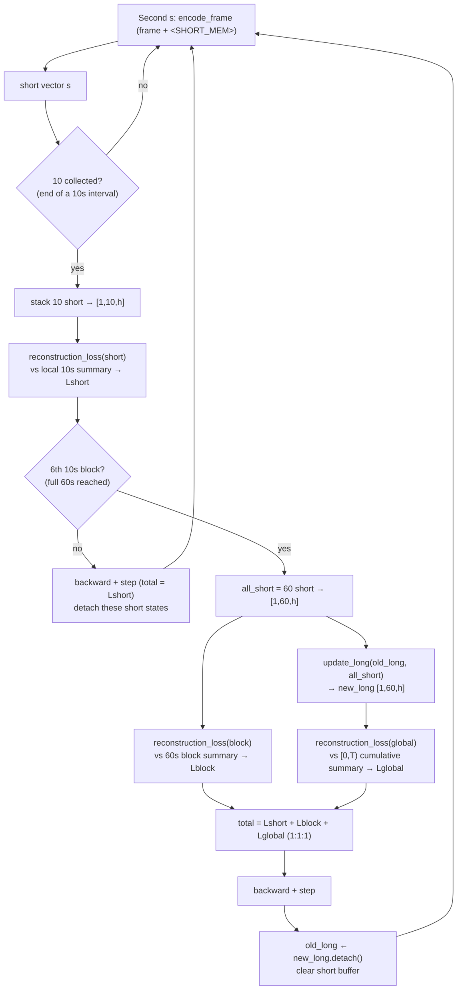

# Stage 2 — chronological visual memory on Qwen3.5

> 当前冻结数据的普通记忆 / 秒级 Q-Former 全量训练使用 [FULL_TRAINING.md](FULL_TRAINING.md) 和 `stage2.train_full`。本文的 `stage2.train`、八卡 DDP 及每分钟 6 次更新属于保留的旧训练入口，不等同于全量独立监督方案。

> The project-level outline (goals, three-stage status, interfaces, run commands)
> lives in the root [`README.md`](../README.md) / [`README_zh.md`](../README_zh.md);
> that is the authoritative entry point. This file keeps only Stage 2 specifics.

This is a new implementation. It does not import code from `pretrain/`.

## Memory flow (diagram)

The figures below are the token-level ground truth for how input frames, the two
memory query tokens, and reconstruction targets are arranged. They come directly
from `stage2/model.py` and `stage2/train.py`; line references are inline.

### Three forward passes (token arrangement)

```text
① encode_frame  — one per completed second → one SHORT vector   (model.py:50-65)
   each second is an INDEPENDENT forward (no KV carried across seconds):

      [chat header] <image tokens for this 1s> <SHORT_MEM> [chat footer]
                                                     │
                           take hidden state at <SHORT_MEM>  →  short vector [1, hidden]
   NOTE: <SHORT_MEM> appears exactly once (model.py:61-63); it only sees
         THIS one frame. Short memory has no cross-second context.

② update_long  — once every full 60s → replaces long memory      (model.py:67-79)

   first minute (no previous long):
      [ 60 SHORT vectors ] [ 60 × <LONG_MEM> query ]
   later minutes:
      [ old long (detached, 60) ] [ 60 SHORT vectors ] [ 60 × <LONG_MEM> query ]
      └──────── 60 ───────────┘ └──────── 60 ───────┘ └──────── 60 ────────┘
                                                               │
                take hidden states of the LAST 60 positions  →  new long memory [1, 60, hidden]
   NOTE: whole-block REPLACEMENT, not append. Length stays 60. Old long is
         detached (no gradient across minutes); history accumulates recursively.

③ reconstruction_loss — teacher-forced CE, training only        (model.py:81-102)

      [ memory vectors ] [ "Summarize ...(kind):\n" prompt ] [ target summary ] [EOS]
      └──── -100 ───────┘ └──────── -100 ──────────────────┘ └──── CE loss here ────┘
   NOTE: memory + prompt are masked to -100; loss is computed ONLY on the
         target summary tokens. memory = 10 short (short) / 60 short (block) /
         60 new long (global), chosen by `kind`.
```

### One minute of training (control flow)



### short vs long

| | `<SHORT_MEM>` | `<LONG_MEM>` |
|---|---|---|
| Produced every | 1 second | 60 seconds |
| Sees | only its own 1 frame | old long + current 60 short |
| Count per readout | 1 vector | 60 vectors (fixed) |
| Across time | independent per-second snapshot, no accumulation | recursive, whole-block replacement, carries history |
| Supervised by | local 10s summary (per 10 vectors) | global `[0,T)` cumulative summary |

Inference (`stage2/stream.py:14-31`) runs only ① and ② (no teacher labels) and
saves `final_long [1,60,h]`, `final_short [1,k,h]` (`k<60`), and per-minute
snapshots for the later QA stage. The local/block/global text summaries exist
only as training targets to make the memory vectors reconstructable.

## Overview

Generate visual-only teacher labels from silent video clips using a multimodal
model on an OpenAI-compatible Chat Completions endpoint. For Gemini via
OpenRouter, set `OPENROUTER_API_KEY`:

```bash
python -m stage2.annotate --video /path/to/video1.mp4 \
  --video-id video1 --model google/gemini-3.1-pro-preview \
  --base-url https://openrouter.ai/api/v1 \
  --api-key-env OPENROUTER_API_KEY \
  --frame-size 224 \
  --output /path/to/video1_teacher.jsonl
```

For Qwen3.5 on the SSH cluster's vLLM, use `--model Qwen/Qwen3.5-35B-A3B`, its
`--base-url`, `--api-key-env VLLM_API_KEY`, and `--clip-dir` pointing into a
directory allowed by the vLLM server's local-media setting. The server must
share access to that filesystem. `--transport` defaults to OpenRouter's
base64 `file` content for Gemini and local `video_url` for other models, and
can be set explicitly. `--video-fps` optionally overrides vLLM video decoding;
by default the backend controls it. The
annotator creates exact silent video windows; it does not select image frames
or pass audio/ASR. The provider can still sample or limit frames internally.
At every complete minute boundary `T`, it
writes exactly **eight JSONL records**: six local labels for
`[T-60,T-50)`, ..., `[T-10,T)`; one independent block label for
`[T-60,T)`; and one cumulative label for `[0,T)`. For example, at `T=60`,
the windows are `0-10`, `10-20`, `20-30`, `30-40`, `40-50`, `50-60`,
`0-60` (block), and `0-60` (global). The last two have different
`label_type` values and different prompts despite sharing a window at the
first minute. At `T=120`, the block window is `60-120` and the global window
is `0-120`. For an incomplete
last minute, it labels only complete 10-second intervals. A failed call leaves
earlier **complete** blocks on disk; run with `--resume` to continue. Existing
output is protected unless `--resume` or `--overwrite` is explicit. Longer
global clips increase input cost and may hit the provider's duration, size, or
context limits. Teacher summaries still require visual-quality review.

`stage2.build_data` groups the eight event records into one chronological
training block while checking that all eight targets and windows are present:

```bash
python -m stage2.build_data \
  --teacher-jsonl /path/to/video1_teacher.jsonl /path/to/video2_teacher.jsonl \
  --output /path/to/blocks.jsonl
```

The builder accepts either block rows with `local_sub_summaries`,
`block_summary_target`, and `global_summary_target`, or event rows with
`label_type` = `local_10s` / `block_60s` / `global_prefix`, plus `video_id`,
`block_window`, `window`, and `target`. It checks chronology, all six 10-second
windows, independent 60-second and cumulative targets, and optional
`block_summary_window` / `global_window`. A legacy file containing only one
60-second `local_summary_target` per block is rejected; the missing 10-second
and independent block labels cannot be reconstructed from it.

Teacher targets use schema `stage2_facets_v1`: clauses are separated by
semicolons and written as `Facet: content`. The seven permitted facet labels
are `View`, `Anatomy`, `Probe`, `Finding`, `Dynamic`, `Measure`, and `Change`.
The local, block, and global plans use partly overlapping subsets with different
emphases and 40/80/90-word experiment budgets. `stage2.annotate` validates and
retries malformed teacher output (three attempts by default); `stage2.build_data`
parses every target again and rejects unknown, duplicated, disallowed, or
out-of-order facets. Parsed `facets`, `schema_version`, and annotation settings
are retained in the generated data for auditability.

The resulting JSONL contains one chronological block per row:

```json
{"video_id":"video1","block_window":[0,60],"local_sub_summaries":[{"window":[0,10],"local_summary_target":"..."}],"block_summary_target":"...","global_summary_target":"..."}
```

For a full block, provide **six** 10-second `local_sub_summaries`; the compact
example above shows only the first entry. A last incomplete block may contain
fewer complete 10-second labels; it never triggers a long update. Labels must
be visual-only summaries generated from exactly their stated video intervals.

```bash
torchrun --standalone --nproc_per_node=8 -m stage2.train \
  --model-name Qwen/Qwen3.5-2B \
  --train-jsonl /path/to/blocks.jsonl \
  --video-path-map /path/to/video_path_map.json \
  --output-dir /path/to/stage2_output \
  --init-adapter /path/to/stage1_output/final
# Resubmit the identical command with --resume after an epoch-boundary preemption.
# Do not change the model, adapters, data, split, rank, schedule, or epoch count.
python -m stage2.stream --video /path/to/video.mp4 \
  --adapter-path /path/to/stage2_output/final \
  --output /path/to/memory_state.pt
python -m stage2.evaluate --eval-jsonl /path/to/held_out_blocks.jsonl \
  --video-path-map /path/to/video_path_map.json \
  --adapter-path /path/to/stage2_output/final \
  --output /path/to/reconstruction_losses.jsonl
```

`torchrun` activates single-node DDP automatically; the same module still works
with plain `python -m stage2.train` on one GPU. DDP assigns each complete video
to exactly one rank and greedily balances ranks by the number of labelled
10-second updates, so temporal state is never split across GPUs. Uneven shards
are handled with DDP Join. Validation sums and counts are reduced over all
ranks, only rank 0 writes checkpoints, and training metrics are written as
`training_metrics.rank0.jsonl`, ..., `training_metrics.rank7.jsonl`.
The packaged `scripts/slurm/run_stage2_train_ddp.sbatch` defaults to two x4
nodes (eight ranks total), matching the LRZ `*80x4`/`*94x4` node shape. It can
also be overridden to one x8 node; submit it with the appropriate partition.
`global_step` counts synchronized optimizer rounds (the longest video shard),
not the sum of per-rank video updates. A shorter rank may log fewer local
updates before DDP Join, while rank 0 still completes every round.

Before committing to an eight-GPU run, use two GPUs and a fresh tiny dataset
with at least two videos. Add `--verify-ddp-gradients` to the normal training
command; immediately after the first backward pass and before clipping or the
optimizer step it compares a complete LoRA gradient across both ranks. A
successful check prints `[ddp-check] synchronized gradient` on rank 0; a
mismatch stops training. The packaged smoke job uses two real videos and
**synthetic test summaries**, so it does not require completed teacher labels.
It runs one full minute (six steps, block/global losses) against one ten-second
interval (one step, then DDP Join), then checks the logs and checkpoint:

```bash
cd /path/to/live-ultrasound-video-understanding
mkdir -p logs
sbatch --export=ALL,VIDEO_MAP=/path/to/video_paths.json \
  scripts/slurm/run_stage2_ddp_smoke.sbatch
```

The default partition is `mcml-hgx-h100-94x4` with `qos=mcml`; override
these with `sbatch --partition=... --qos=...` if needed. Set `REPO`/`DATA` in
`--export` when the remote paths differ. The job writes to
`$DATA/results/stage2_ddp_smoke/<job_id>/` and prints `[smoke] PASS` only after
all checks succeed. These test targets are not clinical labels and the saved
adapter must not be used for evaluation or further training.
Set `STAGE1_ADAPTER=/path/to/stage1_output/final` in `--export` to exercise
the full Stage 1 → Stage 2 loading path; without it, the smoke starts from the
same Qwen3.5 base and still tests Stage 2 DDP.

To run the same check interactively instead:

```bash
torchrun --standalone --nproc_per_node=2 -m stage2.train \
  --model-name Qwen/Qwen3.5-2B \
  --init-adapter /path/to/stage1_output/final \
  --train-jsonl /path/to/two_video_smoke_blocks.jsonl \
  --video-path-map /path/to/video_path_map.json \
  --output-dir /path/to/fresh_stage2_ddp_smoke \
  --validation-fraction 0 \
  --verify-ddp-gradients
```

For the three-stage mainline, `--init-adapter` points to the Stage 1 adapter and
must have been trained from the exact same `Qwen/Qwen3.5-2B` base. Omitting it
is a Stage 2-from-base ablation, not the full pipeline. Training writes
per-update component losses, learning rate, gradient norm, and `global_step` to
`training_metrics.jsonl`; held-out component means and their summed selection
metric go to `validation_metrics.jsonl`. Each `epoch-N` directory contains the
adapter plus `trainer_state.pt` with optimizer, scheduler, RNG, epoch, and step
state. `--resume` restores the latest fully completed epoch only; it does not
resume inside a video or epoch. The video split and invariant experiment config
must match, including DDP world size (an 8-GPU run resumes on 8 GPUs). The
lowest held-out summed loss is also saved under `best/`.
Streaming output contains minute-boundary long
snapshots and final long/short tensors for a later QA stage. This implementation
has unit tests for chronology and loss scheduling, plus a held-out
teacher-forced reconstruction-loss evaluator. A complete Qwen3.5 GPU run and
generated-summary or downstream memory-quality evaluation remain to be performed.
Stage 2 uses PEFT's
`trainable_token_indices` to train only the two new query-token embeddings
alongside LoRA; use a PEFT version that supports this option. If Stage 1 was
merged before Stage 2 training, streaming reads that adapter path from the
adjacent `training_config.json`; supply `--base-adapter` if the path moved.
